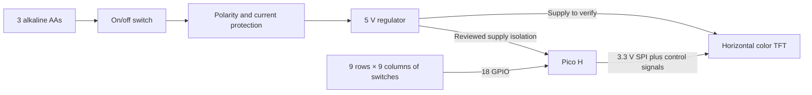

# Preliminary architecture

Status: technical proposals from 2026-10-08, process updated 2026-10-17. The separate prototype remains skipped. PCB design with AI assistance is now the preferred route to investigate, with flexible but controlled spending; follow the [PCB learning plan](pcb-learning-plan.md). The earlier hand-wired budget is a comparison baseline. Dimensions identified as estimates are design allowances, not manufacturing data.

## Recommended electronics



Use a **Pico H and a 2.4-inch rectangular color SPI display**. The current recommendation is Elecrow DLS22024B-NT (Ohne Touch) from BerryBase; it consolidates the component order and replaces Waveshare 18366 as the purchasing default. The user accepted the equation-plus-dot-array mockup. The Pico has enough connections for the whole board; GPIO expanders and a second controller add no useful benefit. Bench checks use final parts during assembly. See the [current order list](order-list.md), checked 2026-10-18.

### Component shortlist

| Component | Verified information | Assessment / unresolved detail |
| --- | --- | --- |
| Raspberry Pi Pico H, RP2040 | 26 exposed GPIO, two SPI controllers, USB; header-equipped version available | Recommended: sufficient for a few text labels and matrix scanning. Pico board envelope about 51 × 21 mm; connector/header height and installation space still need measurement. [Raspberry Pi documentation](https://www.raspberrypi.com/documentation/microcontrollers/pico-series.html), [Pico H listing](https://www.berrybase.de/raspberry-pi-pico-rp2040-mikrocontroller-board-mit-headern) |
| Pico 2 with headers, RP2350 | 26 GPIO, 520 kB RAM, 4 MB flash; 51 × 21 mm listed | Acceptable alternative for €1 extra. More memory is optional for this task. Use pull-up matrix scanning; check the selected firmware's RP2350 notes. [Official documentation](https://www.raspberrypi.com/documentation/microcontrollers/pico-series.html), [listing](https://www.berrybase.de/raspberry-pi-pico-2-rp2350-mikrocontroller-board-mit-headern) |
| Waveshare 17344, 2-inch IPS, ST7789 family | 240 × 320 pixels; SPI; board 58 × 35 mm; active area 40.80 × 30.60 mm in landscape; supplied 8-wire cable | Earlier budget option, superseded by the selected larger display direction. [Manufacturer](https://www.waveshare.com/product/displays/lcd-oled/2inch-lcd-module.htm) |
| Elecrow DLS22024B-NT, 2.4-inch TFT, ILI9341, no touch | 320 × 240 pixels in landscape; SPI; board 77.18 × 42.72 mm; active area 48.96 × 36.72 mm; 3.3–5 V supply, 3.3 V logic | Current purchasing recommendation, €7.50 at BerryBase; add separate 20 cm female–female jumper cable (€1.80). Verify the actual pin header, mounting holes, backlight/power circuit and desk viewing angle. [Listing](https://www.berrybase.de/elecrow-2-4-zoll-tft-lcd-modul-320x240-pixel-spi-ili9341-tf-slot-microsd-arduino-stm32-3-3-5v), [manufacturer pinout/specifications](https://elecrow.com/wiki/2.4_inch_320x240_SPI_Serial_TFT_LCD_Module_Display_With_Driver_IC_ILI9341With_Touch_Function.html) |
| Waveshare 18366, 2.4-inch TFT, ILI9341 | 240 × 320 pixels; SPI; board 70.50 × 43.30 mm; active area 48.96 × 36.72 mm in landscape | Earlier implementation target, now fallback. Its supplied PH2.0 cable and mounting layout differ from Elecrow; do not transfer footprints or pin order. [Listing/specifications](https://www.welectron.com/Waveshare-18366-24inch-LCD-Module) |
| Waveshare 23822, 1.9-inch IPS, ST7789V2 | 170 × 320 pixels; board 51.2 × 27.3 mm; landscape active area 42.72 × 22.70 mm | Useful narrow shape, but German price/stock not verified. No clear saving over the 2-inch module, so keep as a reserve. [Manufacturer](https://www.waveshare.com/product/displays/lcd-oled/1.9inch-lcd-module.htm) |
| BerryBase KHT66PV43, normally-open through-hole switch | Body 6 × 6 mm; PCB-to-actuator height 4.3 mm; 1.6 N nominal force; terminal pitch 4.5 × 6.5 mm listed | Recommended sample. Full drawing, travel, lifetime, and batch consistency remain unverified. Check the actual part and contact pairs before mechanical design. [Product specifications](https://www.berrybase.de/kurzhubtaster-vertikale-printmontage-6x6mm-h-4-3mm) |
| Reichelt TASTER 3301 | 6 × 6 × 4.3 mm; 1.6 N; 0.25 mm travel listed | More expensive documented fallback. Its linked APEM family drawing is useful, but must not be assumed to describe the BerryBase part. [Product](https://www.reichelt.de/de/de/shop/produkt/kurzhubtaster_6x6mm_hoehe_4_3mm_12v_vertikal-27892), [linked family datasheet](https://cdn-reichelt.de/documents/datenblatt/C200/PHAP33_DB_EN.pdf) |

Avoid buying a bare LCD panel, a touch version, a Linux Raspberry Pi display HAT, or a Pico plug-on display that occupies GPIO needed for the matrix. Match the exact module SKU, connector, and cable contents.

## Matrix and pin budget

Each switch closes one row-to-column connection. Nine rows plus nine columns use **18 GPIO**. The display needs clock, MOSI/DIN, CS, DC, reset, and backlight control: **6 GPIO**. Total **24 of 26**, leaving two spare; display readback/MISO is unnecessary.

Use 3.3 V logic and a shared ground. The Elecrow display signals used here are `VCC`, `GND`, `CS`, `RESET`, `DC/RS`, `SDI(MOSI)`, `SCK`, and `LED`. `SDO(MISO)`, touch and SD-card connections are unnecessary. The listing specifies 3.3–5 V supply and 3.3 V logic; the proposed regulated power-module output is the candidate VCC supply, subject to actual regulator/backlight schematic and current checks. A USB VBUS-only supply would fail when running from battery. Never power the display from a GPIO or apply 5 V to Pico signal pins; the LED pin's current/control requirements remain unverified. The previous Waveshare PH2.0 connector and cable are not part of this module; use the separate female–female cable and reserve space for its header. [Elecrow pinout/specifications](https://elecrow.com/wiki/2.4_inch_320x240_SPI_Serial_TFT_LCD_Module_Display_With_Driver_IC_ILI9341With_Touch_Function.html)

Firmware scanning must drive only the selected row low and leave other rows as inputs with pull-ups. This avoids strong high/low output contention if two keys are held. A diode-free matrix can still ghost with three keys at corners of a rectangle: software cannot reconstruct the intended simultaneous keys. Reject multi-key patterns and wait for full release. Add per-key diodes only if later testing shows overlapping presses must be supported; that adds 81 parts and soldering.

Four-leg tactile switches usually expose two internally common pairs, not four independent contacts. Confirm pairs with an unpowered continuity test; connecting a row and column to the same common pair makes a permanently closed key.

Final GPIO and physical header-pin assignments follow the selected board and SPI pinout. This document establishes capacity, not a wiring diagram.

## Disposable AA power and on/off

**Updated 2026-10-18:** the user chose disposable AAs, superseding USB-only and LiPo charging proposals. Engineering default: three alkaline AAs, BH-331-3A holder, POL4941 5 V boost regulator and NIN-S22L rear latching slide switch. These candidates total €7.10 before cells, protection/isolation and wiring. See the [power plan](power.md) for sources, limitations and the complete cost boundary.

Normal use is cable-free. Replace cells through a screw-fastened underside hatch; there is no charging circuit or charging socket. Place the switch before the regulator so it disconnects both Pico and LCD in battery operation. Keep Pico micro-USB accessible for programming/service. Firmware starts blank until a valid keypress, with the same simple learning interface.

Review reverse-polarity/current protection, a suitable low-voltage stop, display supply/backlight requirements, startup with partly used cells and isolated Pico VSYS/USB supply paths before PCB fabrication. The regulator lacks reverse-polarity and short-circuit protection and needs 2.7 V to start. USB must not backfeed it or the disposable cells; Pico USB can power the controller with the battery switch off. These are circuit requirements, not released wiring instructions. [Pololu documentation](https://www.pololu.com/product/4941), [Pico datasheet](https://datasheets.raspberrypi.com/pico/pico-datasheet.pdf).

## Display and firmware

Recommend **CircuitPython** with `keypad.KeyMatrix`, `displayio`/`fourwire`, `adafruit_ili9341`, and `adafruit_display_text` for the current 2.4-inch module target. The earlier 2-inch option used `adafruit_st7789`. These drivers exist, but the exact module's rotation, RGB/BGR order, inversion, and offsets still need bench validation. Record the stable CircuitPython release and matching library-bundle versions at implementation. [Pico firmware/support](https://circuitpython.org/board/raspberry_pi_pico/), [ST7789 driver](https://docs.circuitpython.org/projects/st7789/en/latest/), [ILI9341 driver](https://docs.circuitpython.org/projects/ili9341/en/latest/)

`KeyMatrix` provides native scanning and debounce. Its current implementation returns inactive rows to input mode; verify that behavior in the release used. Start with an approximately 5 ms scan interval and a debounce threshold around four samples, then tune to measured behavior. Drain pending events before evaluating the held-key set; allow an equation only for a stable singleton pattern. Use `columns_to_anodes=True` for pull-up/active-low scanning, even without diodes. The API documents an RP2350 pull-down limitation, so use the same pull-up approach on either Pico generation. [API](https://docs.circuitpython.org/en/latest/shared-bindings/keypad/index.html), [implementation](https://github.com/adafruit/circuitpython/blob/main/shared-module/keypad/KeyMatrix.c)

Represent the equation as five tokens: factor, ` × `, factor, ` = `, product. Give each number token one parity-based color and measure token widths to center the complete line. Allocate the labels once and update them together. Add a small neutral dot array below: first-factor rows, second-factor columns, fixed pitch and dot size, with room for 9 × 9. The mockup uses approximately 1.9 mm dots on 2.6 mm centers; those are layout estimates. Reuse a small bitmap/tile or allocated shapes instead of requiring a full-screen 16-bit framebuffer. Supply a small bitmap font containing digits, space, `×`, and `=`; check font licensing and the actual multiplication glyph.

A 320-pixel landscape line is ample in principle: a ten-character equation at an estimated 20-pixel average advance uses about 200 pixels. Aim initially for 28–36-pixel-tall glyphs, roughly 3.6–4.6 mm on the 2-inch screen. These are calculated layout estimates, not a legibility test. The physical display size and viewing angle matter more than adding resolution.

MicroPython remains a reasonable fallback if the chosen module works better with a tested vendor driver. C/C++ is unnecessary unless measured performance or library reliability demands it. The device operates offline with one small program.

## Printed caps and enclosure

Use individual sliding caps with a broad finger surface and a central pusher. The enclosure guides each cap; the switch is responsible only for the click and return force.

```text
       label under clear film
       ┌─────────────┐
       │  cap face   │  ← off-white, approximately 15 mm square
guide  │             │  guide
───────┤             ├───────  teal top plate
       └─┐         ┌─┘  ← captive flange below plate
         └────┬────┘
           pusher
             ↓
       tactile actuator
       [ switch body ]  ← rigid carrier or supported PCB
       ───────────────
```

The flange prevents a cap being pulled out; a skirt or guide rails reduce tilt and rubbing. Load from hard pressing must reach a mechanical stop through the housing, with the switch body firmly supported below. Add clearance around switch legs and wiring. Do not glue a wide cap to the tiny round actuator and expect it to guide the movement.

Short travel is the main risk. The fallback switch lists 0.25 mm travel; the proposed cheaper switch's travel is unverified. Printed tolerances can be comparable to that movement. Test guide clearance, pusher length, shims, and stop height on one key before printing nine. Neither a permitted overtravel nor a safe hard-press force has been established for the chosen switch. Adjust stops using the actual sample rather than adopting a nominal travel value as a design limit. The switch's own spring should return a light cap, but corner pressing and guide friction must be tested.

Use ordinary PLA for the first rigid parts; select final material from actual fit and robustness results. Avoid printed flexure springs at this stage. Screw-open top and bottom parts and a replaceable carrier are simpler to tune and repair than glued assemblies. Support a full PCB at several points to limit flex. Keep the Pico's USB socket close to the rear edge with room for the actual plug; secure the board so cable force is carried by the enclosure.

### Provisional size

The accepted concept uses the 2.4-inch equation/array display and printed-in shell decoration. A gentle rear-up tilt is now proposed: start with 5 degrees, using a hollow wedge-shaped lower shell and non-slip feet. Keep the guide plate and PCB parallel, with uniform switch-to-cap geometry. Across a 230 mm top, this adds approximately `230 × sin(5°) = 20 mm` rear elevation; the earlier 26 mm thickness sketch would become approximately 26 mm at the front and 46 mm at the rear. These are design illustrations, not measured stack clearances or an agreed tilt angle. Check reach and actual display viewing angle before fixing the base.

Integrate decorative relief or inlays into the shell CAD, away from moving caps, screw access and the display opening. Select the artwork, print orientation and feasible color process together; the earlier sticker mockup illustrates appearance only. Keep the artwork editable independently of component/mounting geometry.

- Start with **18 mm key-center pitch and 15 mm cap faces**: grid face span `8 × 18 + 15 = 159 mm`.
- Allow approximately 10 mm left/right margins, a 10 mm bottom margin, and a 55–65 mm display/electronics band above the grid, including the top margin. This gives `159 + 10 + (55 to 65) = 224 to 234 mm` overall height.
- Expected complete envelope: **about 180 × 225–235 × 22–28 mm**. These remain estimates, especially thickness with headers and cables.
- A 180 × 235 mm plate rotated to 235 × 180 mm leaves space on a Prusa MK4's verified **250 × 210 × 220 mm** build volume. Confirm the exact friend's printer, brim, and slicer placement. [Prusa's MK4 specifications](https://blog.prusa3d.com/announcing-original-prusa-mk4_76585/)
- Increasing to 20 mm pitch with 17 mm caps yields a 177 mm grid face; adding borders and the display band can push the long dimension beyond 250 mm. Test finger comfort before locking pitch.

## Labels

| Method | Practical trade-off |
| --- | --- |
| Black print on white adhesive sheet, clear film over it | Recommended first: inexpensive, sharp small text, replaceable. Cut film and label inside the cap edge so neither rubs the guides. Check adhesion and wipe resistance on real prints. |
| Recessed lettering with paint fill | One filament color, potentially durable; fine strokes and painting 81 unique faces take time. Test the real nozzle and font before choosing. |
| Two-color printing | Can be sharp with the right settings; a stock MK4 does not by itself establish automatic multicolor capability. Manual layer changes need suitable geometry, while multi-material hardware must already be available. Do not buy it for labels. |

Start with a roughly 12 mm square label area and 3–4 mm glyph height, subject to a paper print at 100% scale. Keep key labels neutral black; parity coloring belongs on the display. Repeatedly rubbing a film-covered sample is more useful than assuming a clear coating will be durable.
