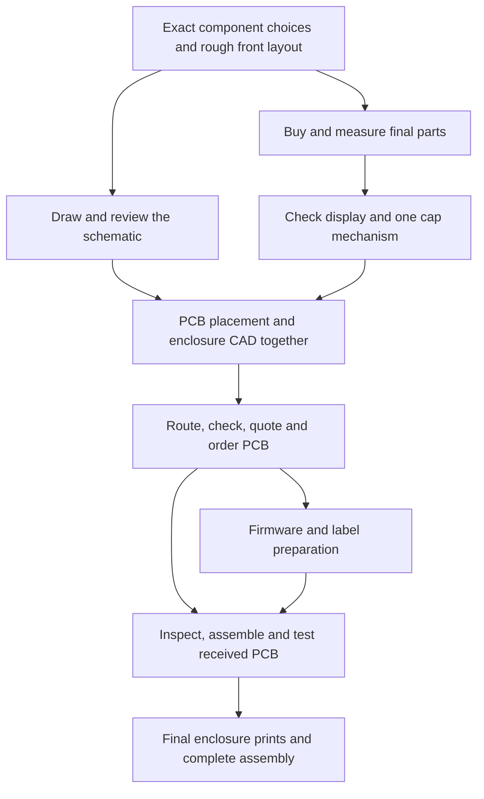

# Build order and dependencies

Updated **2026-10-18**. Current direction: one complete device with disposable AA battery power, PCB design with AI assistance, flexible but controlled spending. The separate 3 × 3 device remains skipped. Follow the [power plan](power.md) alongside this sequence.

The housing is usually called the **enclosure**. Its rough design starts early; its final printing comes late. The PCB, button guides, mounting points, and enclosure must be designed together.

## Sequence

| Stage | Work and result | Dependency / spending |
| --- | --- | --- |
| 1. Desk planning | Select exact switch, display and Pico variants; sketch the full front layout. Start the first-row schematic and expand the circuit once understood. Check printer access and rough board-manufacturing cost. | These tasks can run together. Dimensions remain provisional; no PCB order. |
| 2. Buy the final components | Obtain the selected modules, switches and needed sockets/connectors in coordinated orders. | Review the component budget first. Physical parts are needed for final footprint and fit verification. |
| 3. Verify actual parts and the button mechanism | Measure terminal positions, module outlines, heights, mounting holes, and the actual USB plug/cable. Identify switch contact pairs. Run the actual display and check text/colors. Print one cap/guide section to check travel, return, and corner pressing. | Uses final hardware. This establishes key pitch and the vertical stack before the PCB layout is fixed. |
| 4. Design PCB placement and enclosure together | Place the switches, Pico/socket and display relative to the enclosure. Agree board outline, mounting holes, supports, key-guide positions, screen window, and connector clearances. | Requires verified parts and a workable cap mechanism. Share the same dimensions and coordinates between PCB and CAD. |
| 5. Finish and order the PCB | Route the copper; run electrical/design-rule checks; inspect 1:1 footprint/layout prints and manufacturing files. Obtain the actual complete batch quote, including delivery/tax, and update the total device budget before ordering. | Mechanical interfaces must be agreed first. A paper/3D fit check and design checks do not replace later physical testing. |
| 6. While the PCB is manufactured | Develop and check equation/array formatting, parity, debounce logic and the display driver. Prepare labels and finish the printed shell artwork using the agreed interfaces. | Runs in parallel with fabrication. Hold the large enclosure print until the received board has been checked. |
| 7. Receive, assemble, and finish | Inspect the bare PCB against the layout and mounting dimensions. Solder/check the electronics progressively, then verify the complete matrix and screen. Adjust enclosure CAD if needed, print the full enclosure/cap set, apply labels, assemble, and test the complete device. | Physical board fit and working electronics precede the final large prints. Final checks include cap behavior and reading comfort in the assembled device. |

## Dependency map

## Dimensions to agree before PCB fabrication

- Key-center pitch, matrix orientation, and the switch footprint/contact mapping.
- Relative positions of the board, cap guides, key openings and mechanical travel stops.
- PCB outline and mounting-hole coordinates, fastener clearances, and support locations that limit board flex.
- Controller/socket orientation and height, with a real route for the USB plug and cable.
- Battery holder, insulation, retention and underside hatch; regulator mounting, rear slide switch and power connector locations. Verify reverse-polarity/current protection, low-voltage stop, startup, off-state current and programming-USB isolation before PCB release.
- Display orientation, active window, module supports, and space for its cable/connector.
- PCB thickness and the height of each supporting layer in the enclosure.
- Base tilt, if selected, along with front/rear case heights, board/guide parallelism and clearance for the USB cable at the rear.

Outer corner radii, label artwork, and other details that do not affect those interfaces can be refined later. Any later change to a mounting or component position must be checked against both the PCB and enclosure files.

## Current next step

Use the current Elecrow display and KHT66PV43 switch recommendations, plus the battery/power-module candidates in the [order list](order-list.md). Select the rear power switch/wiring, sketch full placement including the AA holder, hatch and regulator, and review the power circuit alongside the first-row matrix schematic. Settle the proposed tilt and printed shell artwork with the same dimensions. These tasks unlock the coordinated component purchase and physical measurements. No component or manufacturing order has been placed.
